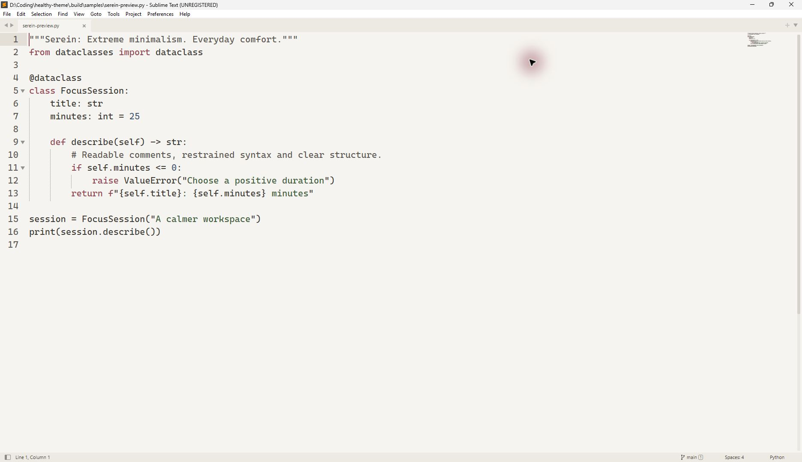
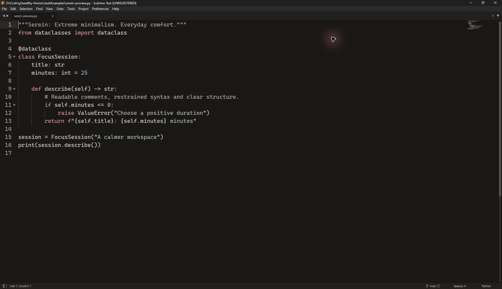

# Serein for Sublime Text — Minimalist Warm UI & Color Scheme

**Extreme minimalism. Everyday comfort.**

Serein for Sublime Text 4 brings low-distraction UI styling and soft, readable syntax highlighting to your favorite lightweight text editor. Available in both light and dark variations:

- **Serein Alabaster (Light):** Calming ivory background with subtle dark syntax for day-time text editing.
- **Serein Obsidian (Dark):** Soothing warm charcoal background that keeps late-night code reviews easy on the eyes.

[Download Latest Release](https://github.com/cmduyeen/serein-sublime-text/releases/latest) · [Full Serein Suite](https://github.com/cmduyeen/serein-theme) · [Read Sublime Setup Guide](https://cmduyeen.github.io/)

---

## Preview

| Serein Alabaster · Light Mode | Serein Obsidian · Dark Mode |
|---|---|
|  |  |

---

## Key Highlights

- **Complete Package:** Includes both custom `.sublime-theme` (tabs, sidebar, status bar) and `.sublime-color-scheme` (syntax highlighting).
- **Sublime Text 4 Optimized:** Takes full advantage of ST4 GPU rendering and adaptive tab styling.
- **Checked Contrast:** Meets readability standards without harsh, eye-tiring saturation.

---

## Installation

### Method 1: Automated Script (Windows PowerShell)
In PowerShell 7, run `./install.ps1` to copy `Serein.sublime-package` directly into your Sublime Text `Installed Packages` directory.

### Method 2: Manual Install
1. Download `Serein.sublime-package` from the [Releases page](https://github.com/cmduyeen/serein-sublime-text/releases/latest).
2. Copy the file into your Sublime Text `Installed Packages/` folder:
   - **Windows:** `%APPDATA%\Sublime Text\Installed Packages\`
   - **macOS:** `~/Library/Application Support/Sublime Text/Installed Packages/`
   - **Linux:** `~/.config/sublime-text/Installed Packages/`
3. In Sublime Text, open **Preferences → Select Color Scheme** and pick **Serein Alabaster** or **Serein Obsidian**.
4. Open **Preferences → Select Theme** to apply the matching UI theme.

---

## Complete the Serein Workspace

Pair Sublime Text with other tools in the Serein minimalist suite:

- 💻 **[Serein for VS Code](https://github.com/cmduyeen/serein-vscode)** — Visual Studio Code theme port.
- 🖥️ **[Serein for Windows Terminal](https://github.com/cmduyeen/serein-terminal)** — Warm console color scheme.
- 📓 **[Serein for Obsidian](https://github.com/cmduyeen/serein-obsidian)** — Distraction-free markdown knowledge base.
- 🌐 **[All 10+ Serein Ports](https://github.com/cmduyeen/serein-theme)** — The central hub and design specifications.

---

## Honest Design & Limitations

Themes are aesthetic preferences and visual comfort tools, not medical treatments. Serein has not been clinically tested to treat eye strain. Ambient lighting, glare control, and regular breaks remain essential.
- [American Academy of Ophthalmology: Computer Usage Guidance](https://www.aao.org/eye-health/diseases/computer-usage)
- [Full design reference & limitations](https://github.com/cmduyeen/serein-theme/blob/main/REFERENCE.md)

---

## Author & License

Created and maintained by **[Dyn (cmduyeen)](https://cmduyeen.github.io/)**.
- Personal Blog: [cmduyeen.github.io](https://cmduyeen.github.io/)
- GitHub: [@cmduyeen](https://github.com/cmduyeen)

Released under the [MIT License](LICENSE).
